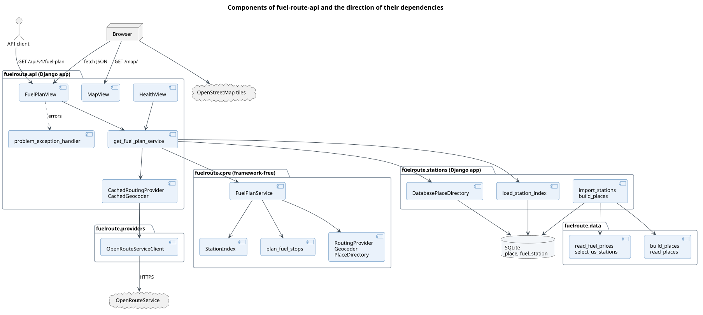
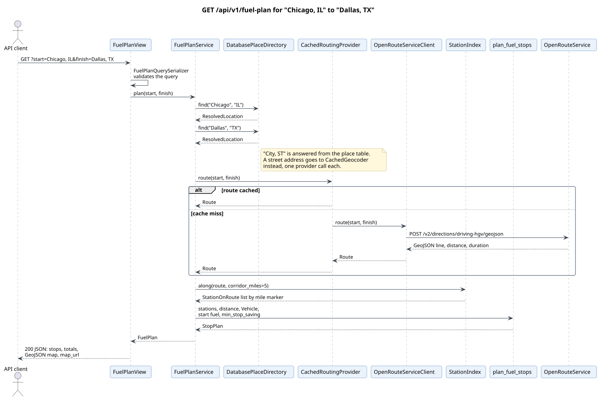
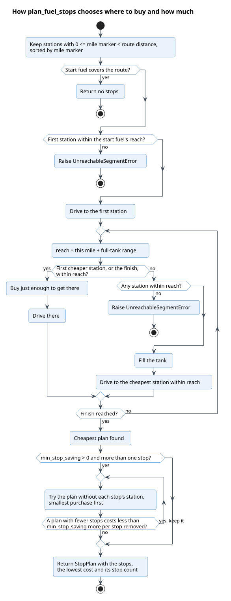

# Design of the fuel route API

| Document | Version | Status | Owner | Last updated |
| --- | --- | --- | --- | --- |
| Design of the fuel route API | 0.7 | Draft | fuel-route-api contributors | 2026-11-25 |

## 1. Purpose

This document describes what the fuel route API does, how it is built, and how it is tested. It is the single design document of the project: it holds the requirements, the architecture, the planning algorithm, and the test plan with its traceability matrix. The decisions behind the design are recorded in the [architecture decision records](adr/README.md).

The service answers one question: where should a truck with a 500-mile range buy diesel between two US locations so that the trip costs the least? It also reports what the fuel costs in total.

## 2. Scope and context

The service is a Django application that exposes one JSON endpoint, a map page and a health check. It calls [OpenRouteService](https://openrouteservice.org/) at `api.heigit.org` for the route and, for street addresses only, for geocoding. Fuel prices come from the OPIS truck stop file supplied with the brief, stored in `data/fuel-prices.csv`.

Out of scope: user accounts, live price feeds, routes outside the USA, waypoints, and choosing among alternative routes. The route the provider returns is the route the plan follows.

### 2.1 Definitions

| Term | Meaning |
| --- | --- |
| Fuel station | A truck stop from the price file, with its retail price per gallon. In code: `FuelStation`. |
| Corridor | The band of `FUELROUTE_CORRIDOR_MILES` (default 5) on each side of the route. Only stations inside it are considered. |
| Mile marker | The distance along the route, in miles, of the route point closest to a station. |
| Stop plan | The purchases chosen for a route. In code: `StopPlan`. |
| Lowest-cost plan | The plan that minimises the cost of fuel bought, before stops that save little are dropped. |

### 2.2 Constraints

| ID | Constraint |
| --- | --- |
| C-01 | The application uses the latest stable Django release, 6.1. |
| C-02 | Routing uses a free API. OpenRouteService was chosen ([ADR-0001](adr/0001-use-openrouteservice-for-routing-and-geocoding.md)). |
| C-03 | Prices come from the supplied file as it is; the file has no coordinates. |
| C-04 | A request should make one call to the routing API; two or three are acceptable. |

### 2.3 Assumptions

| ID | Assumption |
| --- | --- |
| A-01 | The vehicle starts with a full tank unless the request says otherwise. The cost counts only fuel bought on the way. |
| A-02 | The vehicle has a 50-gallon tank and does 10 miles per gallon, so its range is 500 miles. |
| A-03 | A station stands at the point of its town, as given by the Census Bureau or GeoNames. Its true position is usually within a few miles. |
| A-04 | The short detour from the route to a station is not counted in the cost or the range. |
| A-05 | Prices are US dollars per gallon. Where the file lists one station ID several times, the lowest price applies. |

## 3. Requirements

Priorities follow MoSCoW: M (must), S (should), C (could). Every requirement is met in release 0.1.0.

### 3.1 Functional requirements

| ID | Requirement | Priority |
| --- | --- | --- |
| RTE-01 | The API shall accept a start and a finish as `City, ST`, as `latitude,longitude`, or as a street address. | M |
| RTE-02 | The API shall return the route as GeoJSON, simplified to within `FUELROUTE_MAP_TOLERANCE_METERS` (default 50 m) of the full line, together with a link to a map page that draws it. | M |
| RTE-03 | The API shall reject a location that resolves outside the USA with status 422. | M |
| RTE-04 | The API shall resolve `City, ST` from its own place table, without calling a provider. | S |
| FUEL-01 | The API shall return the fuel stops that reach the finish at the lowest cost for a vehicle with a 500-mile range. | M |
| FUEL-02 | The API shall return the total cost of the fuel bought, at 10 miles per gallon. | M |
| FUEL-03 | The API shall price fuel from the supplied price file. | M |
| FUEL-04 | The API shall accept the fuel in the tank at the start, defaulting to a full tank. | S |
| FUEL-05 | The API shall drop a stop whose station saves less than `min_stop_saving` dollars (default 5), and shall report the cost and stop count of the lowest-cost plan beside the returned plan. | S |
| FUEL-06 | When no station lies within range, the API shall respond with 422 and the mile where the fuel runs out. | M |
| DATA-01 | The import shall keep US stations only, keep the lowest price per station ID, and give each station the coordinates of its town. | M |
| DATA-02 | The import shall replace the stored data in one transaction, so a failed import leaves the previous data in place. | S |

### 3.2 Non-functional requirements

| ID | Requirement | Verified by |
| --- | --- | --- |
| NFR-01 | Matching stations to a 2,800-mile route and planning the stops shall take at most 100 ms, provider calls excluded. | `tests/benchmarks/test_planning_speed.py`, `make bench` |
| NFR-02 | A request shall make at most one routing call and two geocoding calls; a repeated request within `FUELROUTE_CACHE_SECONDS` shall make none. | Integration tests that count calls to the fake provider |
| NFR-03 | A provider call shall time out after `ORS_TIMEOUT_SECONDS` (default 10) and shall be retried once after a timeout, a connection error, or status 502, 503 or 504. | `tests/unit/test_openrouteservice.py` |
| NFR-04 | Every error response shall use the RFC 9457 problem details format with a stable `code`. | Integration tests of each error |
| NFR-05 | A location shall be at most 200 characters, and an anonymous client shall make at most `FUELROUTE_RATE_LIMIT` requests (default 60 a minute). | Integration tests |
| NFR-06 | The server shall refuse to start without an API key, without a secret key outside debug mode, or without stations. | `tests/integration/test_pages_and_startup.py`, `tests/e2e` |
| NFR-07 | Line and branch coverage shall be at least 95 percent, enforced in CI. | `make test-all` |
| NFR-08 | A plan for the 2,776-mile New York to Los Angeles route shall be at most 64 KB. | `test_cross_country_response_stays_lean` |
| NFR-09 | A plan request shall run at most two database queries, each served by the unique `(state, search_key)` index; requests with coordinates and the health check shall run none. | `tests/integration/test_database_access.py` |
| NFR-10 | The service shall run on PostgreSQL 18 when `DATABASE_URL` is set, and on SQLite otherwise, with the same tests passing on both. | CI jobs "Tests on Python" and "Tests on PostgreSQL" |

## 4. Architecture

The code is split into five packages under `src/fuelroute`. Each layer imports only the layers below it, and `import-linter` fails the build when one does not.

| Package | Role | May import |
| --- | --- | --- |
| `fuelroute.api` | Django app: views, serializers, error responses, caching, and the wiring of the service. | everything below |
| `fuelroute.stations` | Django app: the `place` and `fuel_station` tables, the import commands, and the adapters that load them into the core. | `providers`, `data`, `core` |
| `fuelroute.providers` | The OpenRouteService HTTP client. No Django. | `core` |
| `fuelroute.data` | Readers for the price file and the gazetteers. No Django. | `core` |
| `fuelroute.core` | The domain and the use case: geometry, stations, the planner, `FuelPlanService`. No Django, no HTTP. | nothing in the project |

The core defines three ports, `RoutingProvider`, `Geocoder` and `PlaceDirectory`, as `typing.Protocol` classes. The adapters in the upper layers implement them. The core can therefore be tested with fakes and run without Django, and another routing provider needs only a new adapter.

### 4.1 Request flow

1. `FuelPlanView` validates the query with `FuelPlanQuerySerializer`.
2. `FuelPlanService.resolve` turns each location into a point. Coordinates need no lookup. `City, ST` is looked up in the place table. Anything else goes to the geocoder ([ADR-0006](adr/0006-resolve-towns-locally-and-cache-provider-answers.md)).
3. `CachedRoutingProvider` returns a cached route or asks `OpenRouteServiceClient` for one.
4. `StationIndex.along` finds the stations within the corridor and gives each a mile marker ([ADR-0005](adr/0005-match-stations-with-an-in-memory-index.md)).
5. `plan_fuel_stops` chooses the purchases ([ADR-0003](adr/0003-plan-purchases-with-the-greedy-fixed-route-algorithm.md), [ADR-0004](adr/0004-drop-stops-that-save-less-than-a-threshold.md)).
6. `FuelPlanSerializer` renders the plan, the totals and the GeoJSON map. `simplify_path` thins the route line for display; matching in step 4 always uses the full line.

### 4.2 Planning algorithm

On a fixed route the stations form a line, and a greedy rule gives the lowest cost. The rule comes from Khuller, Malekian and Mestre, "To fill or not to fill: The gas station problem" (ACM Transactions on Algorithms, 2011). At each station the planner looks ahead one full tank. If a cheaper station lies within that distance, it buys exactly enough fuel to reach the first such station. Otherwise it fills the tank and drives to the cheapest station within range. The finish counts as the cheapest point of all, so the truck arrives with an empty tank. The run takes linear time apart from the scan for the cheapest station in range.

The lowest-cost plan can stop for one gallon to save a few cents. A second pass removes each stop's station in turn, smallest purchase first. It keeps the plan without the station when that plan has fewer stops and costs less than `min_stop_saving` more per stop removed. On the recorded New York to Los Angeles truck route, this cuts 10 stops to 8 for $0.78 more. A request with `min_stop_saving=0` gets the lowest-cost plan unchanged.

### 4.3 Station data

The price file has no coordinates, so the stations are located once, offline, by town ([ADR-0002](adr/0002-locate-stations-offline-from-public-gazetteers.md)). `manage.py build_places` combines four sources into `data/places.csv`, trying them in this order for each station town:

| Order | Source | Station towns matched |
| --- | --- | --- |
| 1 | `data/place-aliases.csv`, hand-checked | 3 |
| 2 | Census Gazetteer places, 2025 | 3,585 |
| 3 | Census Gazetteer county subdivisions, 2025 | 92 |
| 4 | GeoNames populated places | 133 |

Every Census place is also written out, 32,072 rows in all, so a `City, ST` query for any US town resolves locally. `manage.py import_stations` then loads both files into SQLite: of 8,151 price rows, 620 are Canadian, 905 repeat a station ID, and the remaining 6,626 stations all receive coordinates.

### 4.4 Errors

Each error class carries a stable `code`, and `problem_exception_handler` maps it to a status:

| Code | Status | Cause |
| --- | --- | --- |
| `invalid_request` | 400 | A query parameter is missing or out of range. |
| `invalid_location` | 400 | A location is blank, too long, or has coordinates out of range. |
| `invalid_start_fuel` | 400 | The start fuel is more than the tank holds. |
| `location_not_found` | 422 | Nothing matches a location. |
| `outside_service_area` | 422 | A location resolves outside the USA. |
| `route_not_found` | 422 | No road connects the two points. |
| `route_too_long` | 422 | The route exceeds the provider's 6,000 km (3,728-mile) limit. |
| `unreachable_segment` | 422 | A stretch of the route has no station within range. The body adds `fuel_runs_out_at_mile` and `next_station_mile`. |
| `throttled` | 429 | The client exceeded the rate limit. `Retry-After` says when to retry. |
| `provider_error`, `provider_unavailable` | 502 | OpenRouteService failed or answered with something unreadable. |
| `provider_rate_limited`, `provider_authentication_failed` | 503 | The provider quota is used up, or the API key is wrong. The key problem is logged and not shown to the client. |
| `provider_timeout` | 504 | OpenRouteService did not answer in time. |
| `internal_error` | 500 | Any other failure. The details are logged, not returned. |

### 4.5 Deployment

`compose.yaml` runs the production shape on one machine:

| Service | Image | Role |
| --- | --- | --- |
| `api` | `fuel-route-api` | gunicorn with 2 workers and 4 threads each and no control socket, read-only file system, port 8000. |
| `setup` | `fuel-route-api` | Runs `migrate` and `import_stations` once, then exits; `api` waits for it to succeed. |
| `postgres` | `postgres:18.7-alpine` | The `place` and `fuel_station` tables ([ADR-0008](adr/0008-store-data-in-postgresql-in-production-and-sqlite-in-development.md)). |
| `redis` | `redis:8.12-alpine` | The shared cache and rate-limit counters, 128 MB, least-recently-used eviction, no persistence ([ADR-0007](adr/0007-share-the-cache-through-redis-when-configured.md)). |

Only `api` publishes a port. Without `DATABASE_URL` and `REDIS_URL` the same image runs alone on its built-in SQLite database and per-process cache.

### 4.6 Cross-cutting concerns

| Concern | Design |
| --- | --- |
| Start-up | Settings are parsed when the process starts, and a malformed number stops it. `fuelroute.startup.prepare_application`, called from `wsgi.py`, checks the keys and builds the station index, so the first request does not pay for it and a broken deploy never serves. |
| State | The service and the station index are built once per process and never change, so threads share them without locks. Per-request data stays on the stack. |
| Database | Stations are read once at start-up, in one query that selects only the columns the index needs. A request then queries only the `place` table, at most once per end, through the unique `(state, search_key)` index. |
| Caching | Routes and geocoding answers are cached for an hour. Without `REDIS_URL` the cache is per process, at most 256 entries, because request input decides the keys. With it, every worker shares one Redis, bounded by its memory limit ([ADR-0007](adr/0007-share-the-cache-through-redis-when-configured.md)). A cache failure counts as a miss and never fails a request. |
| Security | Input is bounded and validated before any call. The API key travels in a header, never in a URL or a log. Responses carry a Content Security Policy; the map page loads Leaflet with a pinned integrity hash. See [SECURITY.md](../SECURITY.md). |
| Observability | One logger tree, `fuelroute`. Each provider call logs its path, status, attempt and duration; each plan logs its distance, station count, stops, cost and duration. Locations are not logged, because a street address can identify a person. |
| Performance | Matching takes 20 to 30 ms and planning about 12 ms for the 2,776-mile recorded route on a laptop. Calls to the live API took 0.25 to 2.2 s, so the provider sets the response time. |

## 5. Risks and open issues

| ID | Issue | Effect | Next step |
| --- | --- | --- | --- |
| OI-01 | Stations are placed at their town, not their exit. | In a large city a station can sit 10 miles from its town's point and fall outside the corridor, or inside it when it is on another road. | Geocode interstate exits from OpenStreetMap motorway junctions. Planned for 0.2. |
| OI-02 | The detour to a station is not counted. | The real fuel used is a little higher than reported, by at most twice the corridor width per stop. | Add the detour to the planner as a per-stop cost. Planned for 0.2. |
| OI-03 | The stop-dropping pass is a heuristic. | It does not promise the fewest stops for a given extra cost. | An exact dynamic program over stops, if routes with many stations need it. |
| OI-07 | The free OpenRouteService plan allows 2,000 truck routes and 3,000 geocoding requests a day, per the rate-limit headers on 2026-11-25. | A busy day uses up the quota; requests then fail with `provider_rate_limited`. | The cache absorbs repeats; a paid plan or a self-hosted OpenRouteService removes the limit. |
| OI-08 | The provider can move its API. `api.openrouteservice.org` answers `410 Gone` since 2026-11-24; the API is now at `api.heigit.org`. | Until the host is changed, every route fails with `provider_error` (502). | `ORS_BASE_URL` changes the host without a release, and `make test-live` checks the real API before each release. |
| OI-05 | West Coast coverage is thin: 16 stations in California, 29 in Oregon. | Some West Coast routes return `unreachable_segment`. | None in the service; it reports the gap. A fuller price file closes it. |

### 5.1 Resolved issues

| Question | Answer |
| --- | --- |
| Does the vehicle start full or empty? | Full by default; the request can set `start_fuel_gallons` (A-01). |
| Which price applies when a station ID repeats? | The lowest (A-05). |
| Should the plan be the cheapest to the cent? | It drops stops that save less than $5 by default, and reports the lowest-cost plan beside it (FUEL-05). |
| Must several workers share one cache? (OI-04) | Yes, when `REDIS_URL` is set: routes, geocoding answers and rate-limit counters move to Redis ([ADR-0007](adr/0007-share-the-cache-through-redis-when-configured.md)). |
| Must a response carry the full route line? (OI-06) | No. The line is simplified to within 50 m for display, which takes New York to Los Angeles from 15,822 points and about 340 KB to 2,243 points and under 64 KB (RTE-02, NFR-08). |

## 6. Test plan

### 6.1 Levels

| Level | Directory | What runs | Environment |
| --- | --- | --- | --- |
| Unit | `tests/unit` | Core, data readers, the OpenRouteService client with `httpx.MockTransport`, caching wrappers, settings parsers. | No database, no network. |
| Integration | `tests/integration` | The Django app in process: views, serializers, commands, repository, start-up checks, against a fake OpenRouteService on a local port. Cache tests run against a real Redis. | pytest-django on SQLite in memory; `make test-postgres` runs the same tests on PostgreSQL 18. Testcontainers starts Redis and PostgreSQL; tests that need Docker skip without it. |
| End-to-end | `tests/e2e` | `manage.py migrate` and `import_stations` as subprocesses on the committed data, then gunicorn as a subprocess, called over HTTP. | Fake OpenRouteService serving the recorded Chicago to Dallas route. |
| Live | `tests/e2e/test_live_openrouteservice.py` | Two calls to the real OpenRouteService. | Opt-in: `ORS_API_KEY` and `FUELROUTE_LIVE_TESTS=1`, `make test-live`. |
| Benchmark | `tests/benchmarks` | NFR-01 on the recorded New York to Los Angeles route and the full station set. | `make bench`. |

Each test's level marker comes from its directory. Warnings are errors.

### 6.2 Test design

The planner has a property-based test. Hypothesis draws random trips in which every distance and purchase is a whole gallon. The greedy cost must equal the exact optimum, computed by a dynamic program over fuel levels. A second property checks that the stop-dropping pass keeps every plan feasible and never adds more than `min_stop_saving` per stop removed. Parsers are tested with tables of valid and malformed input, and `place_key` with a property over arbitrary text. Every provider failure (timeout, connection error, 401, 403, 404 with codes 2009 and 2010, 400 with code 2004, 429, 5xx, unreadable body) has a test.

### 6.3 Entry and exit criteria

A change enters review when `make check` passes. It can merge when three conditions hold. `make test-all` passes with at least 95 percent line and branch coverage on Python 3.12, 3.13 and 3.14. `make bench` stays within budget. The rendered diagrams match their sources.

### 6.4 Traceability

| Requirement | Tests |
| --- | --- |
| RTE-01 | `test_query_kind_follows_its_form`, `test_coordinates_skip_every_lookup`, `test_street_addresses_cost_two_geocodes_and_one_route` |
| RTE-02 | `test_plan_between_two_towns_calls_the_provider_once`, `test_feature_collection_holds_route_ends_and_numbered_stops`, `test_map_page_uses_a_nonce_and_pinned_leaflet` |
| RTE-03 | `test_service_area_check`, `test_match_outside_the_usa_is_rejected`, `test_unusable_locations_are_rejected_before_routing` |
| RTE-04 | `test_known_town_comes_from_the_place_directory`, `test_place_directory_finds_towns_by_any_spelling` |
| FUEL-01 | `test_greedy_cost_equals_the_exact_optimum`, the simple cases in `tests/unit/test_planner.py`, `test_server_plans_chicago_to_dallas_over_http` |
| FUEL-02 | `test_purchase_rounds_to_a_thousandth_of_a_gallon_and_a_cent`, `test_plan_between_two_towns_calls_the_provider_once` |
| FUEL-03 | `test_rows_are_read_with_whitespace_collapsed`, `test_import_loads_located_us_stations_and_reports_the_rest` |
| FUEL-04 | `test_start_fuel_and_stop_saving_change_the_plan`, `test_start_fuel_above_the_tank_is_rejected` |
| FUEL-05 | `test_stop_saving_a_few_cents_is_dropped`, `test_stop_saving_more_than_the_threshold_is_kept`, `test_dropping_stops_keeps_the_plan_feasible_and_bounded` |
| FUEL-06 | `test_gap_between_stations_names_the_next_station`, `test_route_without_fuel_in_range_reports_where_it_runs_out` |
| DATA-01 | `test_selection_keeps_us_rows_and_the_lowest_price_per_station`, `test_build_matches_each_station_town_from_the_first_source_that_knows_it` |
| DATA-02 | `test_failed_import_keeps_the_old_data`, `test_import_replaces_the_previous_data` |
| NFR-01 | `test_cross_country_plan_fits_the_budget` |
| NFR-02 | `test_repeat_request_is_served_from_the_cache`, `test_same_points_are_routed_once`, `test_geocoding_misses_are_cached_too`, `test_repeat_request_is_served_from_redis`, `test_unreachable_redis_still_answers_from_the_provider` |
| NFR-03 | `test_gateway_error_is_retried_once`, `test_timeout_is_retried_then_reported`, `test_connection_failure_is_retried_then_reported` |
| NFR-04 | `test_invalid_parameters_are_a_problem_response`, `test_unexpected_error_becomes_an_opaque_problem` |
| NFR-05 | `test_query_longer_than_the_limit_is_rejected`, `test_throttled_client_gets_a_problem_with_retry_after`, `test_rate_limit_counts_in_redis`, `test_rate_limit_lets_requests_through_when_its_store_fails` |
| NFR-06 | `test_startup_without_an_api_key_fails`, `test_startup_without_stations_fails`, `test_server_refuses_to_start_without_an_api_key` |
| NFR-07 | CI job "Tests on Python" running `make test-all` |
| NFR-08 | `test_cross_country_response_stays_lean`, `test_every_dropped_point_stays_within_the_tolerance`, `test_a_turnaround_on_the_same_line_is_kept` |
| NFR-09 | `test_plan_between_two_towns_runs_two_queries`, `test_plan_between_coordinates_runs_no_query`, `test_town_lookup_is_served_by_the_unique_index`, `test_station_index_loads_in_one_query` |
| NFR-10 | `make test-postgres` (CI job "Tests on PostgreSQL"), `test_database_url_selects_postgresql_with_kept_and_checked_connections`, `test_database_url_other_than_postgresql_stops_the_process` |

### 6.5 Test data

Test data is committed as source. `tests/fixtures` holds two responses recorded from the OpenRouteService `driving-hgv` profile, and the unit and integration tests build their stations on a straight test road in code. The end-to-end tests import the committed `data/` files.

### 6.6 Risks

The recorded responses age: OpenRouteService can change its format or its routes. The live tests, run with `make test-live`, check the real provider's format. The fake provider in `tests/conftest.py` mirrors its known behaviour, such as answering 406 to a client that does not accept GeoJSON.
